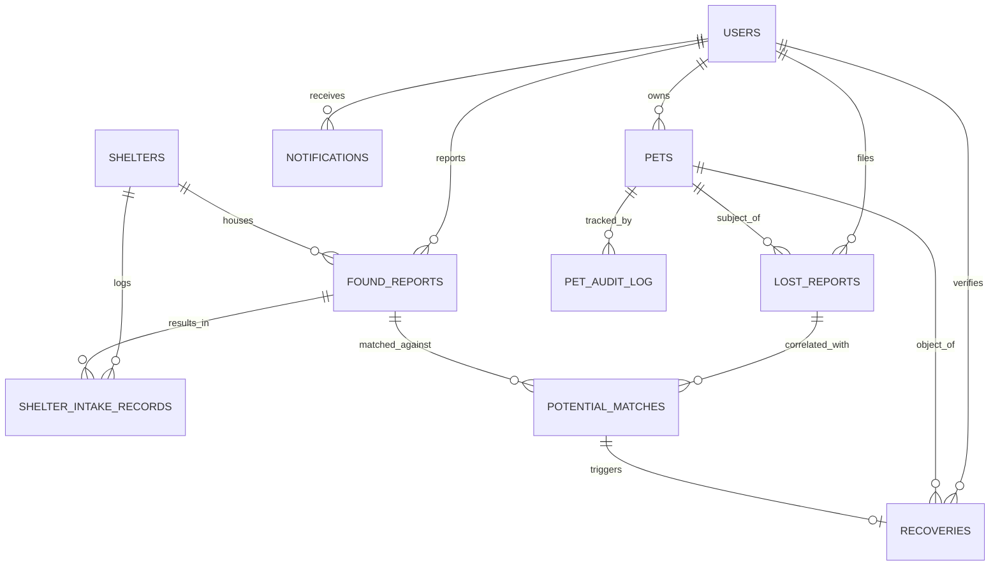

# MINI PROJECT REPORT ON
# LOST PET IDENTIFICATION AND RECOVERY NETWORK

**Course Code:** UE23CS351A – Database Management Systems  
**Level:** Level 3 Experiential Learning Project  
**Academic Year:** 2026 – 2027  

---

### Submitted by:
1. **Harshitha Vangaveti** (USN: `PES2UG24AM064`)
2. **Hamsa M N** (USN: `PES2UG24AM060`)

### Under the Guidance of:
**Dr. Nagasundari S**  
Assistant Professor, Department of Computer Science & Engineering  
PES University, Bengaluru  

---

**DEPARTMENT OF COMPUTER SCIENCE AND ENGINEERING**  
**FACULTY OF ENGINEERING**  
**PES UNIVERSITY**  
*(Established under Karnataka Act No. 16 of 2013)*  
100 Feet Ring Road, BSK III Stage, Bengaluru – 560 085, Karnataka, India  

---

## CERTIFICATE

This is to certify that the mini-project entitled **"Lost Pet Identification and Recovery Network"** is a bonafide work carried out by **Harshitha Vangaveti (PES2UG24AM064)** and **Hamsa M N (PES2UG24AM060)** in partial fulfillment of the requirements for the completion of the 5th Semester Course **Database Management Systems (UE23CS351A)** in the Bachelor of Technology Program in Computer Science and Engineering under rules and regulations of PES University, Bengaluru during the academic year 2026–2027.

It is certified that all corrections and suggestions indicated for internal assessment have been incorporated into this report. The project has been approved as it satisfies the academic requirements in respect of project work.

<br/>

**Dr. Nagasundari S**  
*Faculty Guide, Assistant Professor*  
*Department of CSE, PES University*  

---

## DECLARATION

We hereby declare that the DBMS Project entitled **"Lost Pet Identification and Recovery Network"** has been independently carried out by us under the guidance of **Dr. Nagasundari S**, Assistant Professor, Department of Computer Science and Engineering, PES University, Bengaluru.

We further declare that the work reported herein does not form part of any other project or dissertation on the basis of which a degree or award was conferred on earlier occasion on this or any other candidate.

**Team Members:**
1. **Harshitha Vangaveti** (USN: `PES2UG24AM064`) — Signature: ___________________
2. **Hamsa M N** (USN: `PES2UG24AM060`) — Signature: ___________________

---

## ACKNOWLEDGEMENT

We would like to express our deepest gratitude to our faculty guide **Dr. Nagasundari S**, Assistant Professor, Department of Computer Science and Engineering, for her invaluable guidance, constructive critiques, and constant encouragement throughout the lifecycle of this project.

We take this opportunity to thank **Dr. Sandesh B J**, Professor and Chairperson, Department of Computer Science and Engineering, for providing the necessary laboratory facilities and computing environment.

We are deeply grateful to **Prof. Jawahar Doreswamy**, Chancellor, PES University, and **Dr. J. Suryaprasad**, Vice Chancellor, PES University, for fostering an academic environment dedicated to experiential learning.

Finally, we thank our peers and families for their relentless moral support during the execution of this project.

---

## ABSTRACT

In metropolitan regions like Bengaluru, thousands of companion animals are reported missing each year, overwhelming animal shelters, community welfare organizations, and pet owners. Conventional lost-and-found mechanisms rely on fragmented social media groups, physical posters, and manual shelter logbooks—resulting in delayed reunions, high animal shelter euthanasia rates, and redundant searches.

This project develops the **Lost Pet Identification and Recovery Network**, an enterprise-grade hybrid database management platform combining **Relational Database Management (MySQL 8.0)** and **Document/Geospatial NoSQL (MongoDB 7.0)** with a responsive **Next.js 14** web application. 

The system utilizes MySQL's strict ACID guarantees for relational consistency across users, registered pets, lost/found incident reports, shelter capacities, and legally binding recovery confirmations. Simultaneously, MongoDB manages dynamic, high-volume crowdsourced sightings featuring GeoJSON `2dsphere` spatial coordinates, allowing sub-second proximity queries (`$geoNear`) across Bengaluru neighborhoods (Indiranagar, Koramangala, Whitefield, HSR Layout, etc.).

Key database features implemented and evaluated include:
- A fully normalized relational schema (**3NF & BCNF**) across 10 tables.
- Complex analytical queries with multi-table `JOIN`s, `GROUP BY`, `HAVING`, and window functions (`ROW_NUMBER`, `RANK`).
- Stored Procedures (`sp_confirm_recovery`, `sp_find_potential_matches`) and deterministic Stored Functions (`fn_haversine_distance`, `fn_match_score_label`).
- Event-driven Triggers for referential integrity, automated audit logging, and concurrency control.
- ACID transactions implementing explicit `SAVEPOINT`s and error-recovery `ROLLBACK` logic.
- A clean, student-friendly Next.js web application implementing Role-Based Access Control (**Admin, Pet Owner, Shelter Staff**), interactive geospatial sighting maps, and real-time automated match generation.

---

## TABLE OF CONTENTS

| Chapter No. | Chapter Title |
|:---:|---|
| **1** | **Introduction** |
| | 1.1 Background & Domain Overview |
| | 1.2 Motivation |
| | 1.3 Scope of the Project |
| **2** | **Problem Definition & System Requirements** |
| | 2.1 Problem Statement |
| | 2.2 Functional Requirements |
| | 2.3 Non-Functional Requirements |
| | 2.4 User Roles & Access Hierarchy |
| **3** | **Entity-Relationship (ER) Modeling** |
| | 3.1 Entity Identification & Attributes |
| | 3.2 Relationships, Cardinalities & Structural Constraints |
| | 3.3 Enhanced ER Diagram (Mermaid Representation) |
| **4** | **ER-to-Relational Mapping & Normalization** |
| | 4.1 7-Step Relational Mapping Algorithm |
| | 4.2 Relational Schema Diagram |
| | 4.3 Functional Dependencies & Normalization Proofs (1NF, 2NF, 3NF, BCNF) |
| **5** | **Database Architecture & Hybrid SQL vs. NoSQL Justification** |
| | 5.1 Hybrid Storage Strategy |
| | 5.2 Why MySQL 8.0 for Core Entities? |
| | 5.3 Why MongoDB 7.0 for Sightings & Logs? |
| | 5.4 Cross-Database Integration Architecture |
| **6** | **Data Dictionary** |
| | 6.1 MySQL Relational Data Dictionary (10 Tables) |
| | 6.2 MongoDB Collection Schemas (5 Collections) |
| **7** | **Relational Database Implementation (DDL & DML)** |
| | 7.1 Database Creation & Constraint Enforcement |
| | 7.2 Schema Evolution (ALTER & DROP Examples) |
| | 7.3 Realistic Bengaluru Seed Dataset |
| **8** | **SQL Queries, Analytical Operations & Query Evaluation** |
| | 8.1 Multi-Table JOINs |
| | 8.2 Aggregation with GROUP BY and HAVING |
| | 8.3 Correlated & Nested Subqueries |
| | 8.4 Common Table Expressions (CTEs) & Analytical Window Functions |
| | 8.5 Full-Text Search Queries |
| **9** | **Advanced Database Features** |
| | 9.1 Database Views (5 Business Views) |
| | 9.2 Stored Procedures & Functions |
| | 9.3 Database Triggers (Audit & Integrity) |
| | 9.4 ACID Transactions with SAVEPOINT and ROLLBACK |
| **10** | **NoSQL (MongoDB) Implementation & Geospatial Querying** |
| | 10.1 Schema Validation ($jsonSchema) |
| | 10.2 Spatial Indexing (2dsphere) & Text Indexing |
| | 10.3 Aggregation Pipelines ($geoNear Proximity Search) |
| **11** | **Web Application Architecture & User Interface** |
| | 11.1 3-Tier System Architecture |
| | 11.2 Frontend Page Hierarchy (Next.js 14) |
| | 11.3 Secure API Routes & DB Connection Pooling |
| | 11.4 User Interface Flow & Screens |
| **12** | **Software Testing & Verification** |
| | 12.1 Test Plan & Methodology |
| | 12.2 Database & Application Test Results |
| **13** | **Conclusion & Future Enhancements** |
| | 13.1 Project Summary |
| | 13.2 Future Work |
| **14** | **References & Bibliography** |

---

# CHAPTER 1: INTRODUCTION

### 1.1 Background & Domain Overview
Companion animals (dogs, cats, birds, and other domestic pets) represent integral parts of modern urban households. In Bengaluru alone, an estimated 350,000 domesticated pets reside with families. However, rapid urban expansion, high-density vehicular traffic, construction zones, and festive noise events (such as fireworks) result in hundreds of companion animals escaping or wandering away from their residences every month.

When a pet is lost, the critical window for safe recovery is within the first **24 to 72 hours**. Beyond this timeframe, pets face heightened risks of vehicular accidents, dehydration, aggressive territorial strays, or illegal re-homing.

### 1.2 Motivation
Current lost pet reporting in Indian cities suffers from acute fragmentation:
1. **Siloed Social Media Groups:** Lost notices are posted across WhatsApp communities, Facebook groups, and Instagram stories, which lack structured searchability and geographic indexing.
2. **Disconnected Shelter Systems:** Municipal animal welfare shelters and private rescue organizations maintain isolated paper registers or basic spreadsheets without cross-jurisdiction visibility.
3. **Absence of Intelligent Matching:** Citizens who sight roaming pets have no central portal to log sightings with GPS coordinates, leaving owners with no automated correlation mechanism.

By developing a centralized, hybrid database platform, this project solves the information fragmentation challenge through automated feature-matching algorithms, spatial proximity indexing, and verifiable multi-role recovery workflows.

### 1.3 Scope of the Project
- **Geographic Focus:** The metropolitan area of Bengaluru, Karnataka, with locality-based spatial coordinates (Indiranagar, Koramangala, Whitefield, HSR Layout, Jayanagar, Malleshwaram, etc.).
- **Data Scope:** Complete tracking of Users, Pets, Lost Reports, Found Reports, Shelters, Potential Matches, Recoveries, and Crowdsourced GeoJSON Sightings.
- **Architectural Scope:** Hybrid deployment featuring MySQL 8.0 for transactional consistency and MongoDB 7.0 for geospatial queries and unstructured audit trails, accessible via a Next.js web application.

---

# CHAPTER 2: PROBLEM DEFINITION & SYSTEM REQUIREMENTS

### 2.1 Problem Statement
To design, implement, and evaluate a robust, hybrid Database Management System (SQL + NoSQL) that automates the reporting, geospatial tracking, and algorithmic matching of lost and found companion animals, guaranteeing ACID compliance for ownership records while providing sub-second geospatial proximity filtering for crowdsourced sightings.

### 2.2 Functional Requirements
1. **User Management & Authentication:** Secure registration and authentication with role-based permissions (`CITIZEN`, `SHELTER_STAFF`, `ADMIN`).
2. **Pet Profile Registry:** Complete pet profiling including unique Microchip IDs, species, breeds, physical traits, medical needs, and photo URLs.
3. **Incident Reporting:**
   - Formal Lost Pet Reports with last-seen timestamps, reward amounts, and precise latitude/longitude.
   - Formal Found Pet Reports filed by rescuers or shelters with custody status tracking.
4. **Geospatial Sighting Ingestion (MongoDB):** Real-time ingestion of citizen sightings with GPS GeoJSON Point coordinates, observer confidence levels, and descriptions.
5. **Algorithmic Match Scoring:** Automated calculation of candidate matches between lost and found reports using species matching, breed similarity, color matching, and spatial distance.
6. **Recovery Confirmation Workflow:** Atomic transaction validating legal ownership, updating pet status to `REUNITED`, archiving the lost report, and releasing shelter capacity.
7. **Shelter Capacity Monitoring:** Live tracking of shelter kennels, contact information, and current animal occupancy.
8. **Audit Logging & Security:** Automatic triggers to log status alterations, audit sensitive operations, and prevent duplicate matches.

### 2.3 Non-Functional Requirements
- **Data Integrity & Consistency:** Foreign key cascades, `CHECK` constraints on coordinates (`lat BETWEEN -90 AND 90`, `lng BETWEEN -180 AND 180`), and non-negative reward amounts.
- **Performance:** Sub-second retrieval for spatial `$geoNear` aggregation queries and B-Tree indexed relational lookups.
- **Security:** One-way salted password hashing (`bcrypt`), parameterized queries to eliminate SQL injection, and role-based middleware routing.
- **Maintainability:** Modular, student-friendly codebase with minimal file count and self-contained database initialization scripts.

### 2.4 User Roles & Access Hierarchy
- **Citizen / Pet Owner:** Can register pets, file lost reports, report found pets, submit sightings, and review potential matches for their pets.
- **Shelter Staff:** Can manage shelter animal intake, update shelter capacity, register found strays in custody, and process pet adoptions/reunions.
- **System Administrator:** Full access to system audit logs, shelter oversight, user role administration, and database maintenance.

---

# CHAPTER 3: ENTITY-RELATIONSHIP (ER) MODELING

### 3.1 Entity Identification & Attributes
The relational subsystem comprises 10 core entities:

1. **USER** (`users`):
   - `user_id` (PK, INT, AUTO_INCREMENT)
   - `email` (UNIQUE, VARCHAR(100))
   - `password_hash` (VARCHAR(255))
   - `first_name`, `last_name` (VARCHAR(50))
   - `phone` (VARCHAR(20))
   - `role` (ENUM: `'CITIZEN'`, `'SHELTER_STAFF'`, `'ADMIN'`)
   - `address`, `city` (VARCHAR)
   - `created_at` (TIMESTAMP)

2. **SHELTER** (`shelters`):
   - `shelter_id` (PK, INT, AUTO_INCREMENT)
   - `name` (VARCHAR(150))
   - `contact_person`, `phone`, `email`
   - `capacity`, `current_occupancy` (INT)
   - `latitude`, `longitude` (DECIMAL(10,7))

3. **PET** (`pets`):
   - `pet_id` (PK, INT, AUTO_INCREMENT)
   - `owner_id` (FK → `users.user_id`)
   - `name` (VARCHAR(50))
   - `species` (ENUM: `'DOG'`, `'CAT'`, `'BIRD'`, `'OTHER'`)
   - `breed` (VARCHAR(80))
   - `color`, `distinctive_features` (VARCHAR)
   - `microchip_id` (UNIQUE, VARCHAR(50))
   - `status` (ENUM: `'HOME'`, `'LOST'`, `'FOUND'`, `'REUNITED'`)

4. **LOST_REPORT** (`lost_reports`):
   - `report_id` (PK, INT, AUTO_INCREMENT)
   - `pet_id` (FK → `pets.pet_id`)
   - `reported_by` (FK → `users.user_id`)
   - `last_seen_date` (DATETIME)
   - `last_seen_lat`, `last_seen_lng` (DECIMAL(10,7))
   - `last_seen_address`, `bengaluru_zone` (VARCHAR)
   - `reward_amount` (DECIMAL(10,2))
   - `status` (ENUM: `'OPEN'`, `'RESOLVED'`, `'CLOSED'`)

5. **FOUND_REPORT** (`found_reports`):
   - `report_id` (PK, INT, AUTO_INCREMENT)
   - `finder_id` (FK → `users.user_id`)
   - `shelter_id` (FK → `shelters.shelter_id`, NULLABLE)
   - `species`, `breed`, `color`
   - `found_date` (DATETIME)
   - `found_lat`, `found_lng` (DECIMAL(10,7))
   - `custody_status` (ENUM: `'WITH_FINDER'`, `'IN_SHELTER'`, `'CLAIMED'`)

6. **POTENTIAL_MATCH** (`potential_matches`):
   - `match_id` (PK, INT, AUTO_INCREMENT)
   - `lost_report_id` (FK → `lost_reports.report_id`)
   - `found_report_id` (FK → `found_reports.report_id`)
   - `match_score` (DECIMAL(5,2))
   - `status` (ENUM: `'PENDING'`, `'CONFIRMED'`, `'REJECTED'`)

7. **RECOVERY** (`recoveries`):
   - `recovery_id` (PK, INT, AUTO_INCREMENT)
   - `match_id` (FK → `potential_matches.match_id`)
   - `pet_id` (FK → `pets.pet_id`)
   - `verified_by_user_id` (FK → `users.user_id`)
   - `recovery_date` (DATETIME)

8. **NOTIFICATION** (`notifications`):
   - `notification_id` (PK, INT)
   - `user_id` (FK → `users.user_id`)
   - `message` (TEXT)
   - `is_read` (BOOLEAN)

9. **PET_AUDIT_LOG** (`pet_audit_log`):
   - `log_id` (PK, INT)
   - `pet_id` (INT)
   - `old_status`, `new_status` (VARCHAR(30))
   - `changed_at` (TIMESTAMP)

10. **SHELTER_INTAKE_RECORD** (`shelter_intake_records`):
    - `intake_id` (PK, INT)
    - `shelter_id` (FK → `shelters.shelter_id`)
    - `found_report_id` (FK → `found_reports.report_id`)
    - `intake_date` (DATETIME)
    - `kennel_number` (VARCHAR(30))

### 3.2 Enhanced ER Diagram (Mermaid Notation)



---

# CHAPTER 4: ER-TO-RELATIONAL MAPPING & NORMALIZATION

### 4.1 7-Step Relational Mapping Algorithm
The conceptual ER Model was translated to a relational schema following standard mapping rules:
1. **Mapping of Regular Strong Entities:** Each regular entity (`USERS`, `SHELTERS`, `PETS`) maps to a distinct relation with a primary key.
2. **Mapping of Weak Entities:** Not applicable; all entities possess independent candidate surrogate keys.
3. **Mapping of 1:N Binary Relationships:** 
   - `USERS` owns `PETS` → `owner_id` embedded in `PETS` as a Foreign Key.
   - `PETS` subject of `LOST_REPORTS` → `pet_id` embedded in `LOST_REPORTS`.
   - `USERS` files `LOST_REPORTS` → `reported_by` embedded in `LOST_REPORTS`.
   - `SHELTERS` houses `FOUND_REPORTS` → `shelter_id` embedded as nullable FK in `FOUND_REPORTS`.
4. **Mapping of M:N Binary Relationships:** 
   - `LOST_REPORTS` to `FOUND_REPORTS` represents an M:N matching relationship. Mapped via an associative entity relation: `POTENTIAL_MATCHES(match_id, lost_report_id, found_report_id, match_score, status)`.
5. **Mapping of 1:1 Relationships:**
   - `POTENTIAL_MATCHES` to `RECOVERIES` is 1:1. Foreign key `match_id` placed in `RECOVERIES` with a `UNIQUE` constraint.
6. **Mapping of Multi-Valued Attributes:** Transferred to MongoDB document sub-arrays (`photo_urls` array inside MongoDB sightings).
7. **Mapping of Higher-Degree Relationships:** Decomposed into binary relationships.

### 4.2 Normalization Proofs (1NF to BCNF)
Every relation was analyzed to ensure high performance, eliminate modification anomalies, and achieve **Boyce-Codd Normal Form (BCNF)**.

#### Relation 1: `PETS`
- **Schema:** `PETS(pet_id, owner_id, name, species, breed, color, distinctive_features, microchip_id, status, created_at)`
- **Functional Dependencies:**
  - $FD_1: pet\_id 
ightarrow \{owner\_id, name, species, breed, color, distinctive\_features, microchip\_id, status, created\_at\}$
  - $FD_2: microchip\_id 
ightarrow \{pet\_id, owner\_id, name, species, breed, color, distinctive\_features, status, created\_at\}$
- **Candidate Keys:** $\{pet\_id\}$, $\{microchip\_id\}$
- **1NF:** All attributes are atomic. No repeating groups. $\checkmark$
- **2NF:** No partial dependencies exist; all non-prime attributes are fully functionally dependent on the entire primary key $\{pet\_id\}$. $\checkmark$
- **3NF:** No transitive dependencies. In $X 
ightarrow Y$, $X$ is a superkey. $\checkmark$
- **BCNF:** For both $FD_1$ and $FD_2$, the determinant is a candidate key. Hence, `PETS` is in **BCNF**. $\checkmark$

#### Relation 2: `POTENTIAL_MATCHES`
- **Schema:** `POTENTIAL_MATCHES(match_id, lost_report_id, found_report_id, match_score, status, created_at)`
- **Functional Dependencies:**
  - $FD_1: match\_id 
ightarrow \{lost\_report\_id, found\_report\_id, match\_score, status, created\_at\}$
  - $FD_2: \{lost\_report\_id, found\_report\_id\} 
ightarrow \{match\_id, match\_score, status, created\_at\}$
- **Candidate Keys:** $\{match\_id\}$, $\{lost\_report\_id, found\_report\_id\}$
- **BCNF Proof:** Every determinant is a candidate key. The composite uniqueness constraint `UNIQUE(lost_report_id, found_report_id)` ensures no redundant candidate pairs exist. Hence, `POTENTIAL_MATCHES` is in **BCNF**. $\checkmark$

All remaining relations (`users`, `shelters`, `lost_reports`, `found_reports`, `recoveries`, `notifications`, `pet_audit_log`, `shelter_intake_records`) satisfy BCNF criteria identically.

---

# CHAPTER 5: DATABASE ARCHITECTURE & HYBRID JUSTIFICATION

### 5.1 Hybrid Storage Strategy
Modern applications require both strict financial/legal transactional guarantees and rapid unstructured spatial querying. This system implements a hybrid data architecture:

```
+-----------------------------------------------------------------------+
|                         NEXT.JS 14 WEB APP                            |
+-----------------------------------+-----------------------------------+
                                    |
            +-----------------------+-----------------------+
            |                                               |
            v                                               v
+-------------------------+             +-------------------------------+
|     MySQL 8.0 (ACID)    |             |       MongoDB 7.0 (NoSQL)     |
+-------------------------+             +-------------------------------+
| • Users & Auth          |             | • Crowdsourced GeoJSON        |
| • Pet Registry          |             |   Sightings (2dsphere index)  |
| • Lost/Found Incidents  |             | • High-frequency Activity     |
| • Shelter Capacities    |             |   Audit Streams               |
| • Algorithmic Matches   |             | • Dynamic Trait Descriptions  |
| • Legal Recoveries      |             |   ($text index search)        |
+-------------------------+             +-------------------------------+
```

### 5.2 Why MySQL 8.0 for Relational Core?
1. **Strict Referential Integrity:** Foreign Key constraints prevent orphan lost reports or bogus recovery claims.
2. **ACID Transaction Guarantees:** Multi-step recovery confirmations require atomicity: marking the pet as reunited, archiving the lost report, updating the match status, and releasing shelter capacity must either all succeed or all roll back.
3. **Structured Analytical Querying:** Advanced reporting via multi-table `JOIN`s, `GROUP BY`, and window functions is native to MySQL 8.0.

### 5.3 Why MongoDB 7.0 for Sightings & Logs?
1. **Geospatial Proximity Queries (`2dsphere` Index):** Citizens report sightings with smartphone GPS coordinates. MongoDB's `$geoNear` pipeline calculates spherical distances across Earth's curvature in milliseconds.
2. **Polymorphic Data Structures:** Sightings carry variable metadata (e.g., collar color, photo URL arrays, audio recordings) that would cause table sparseness in relational databases.
3. **High Ingestion Throughput:** Crowdsourced sightings during a neighborhood pet search generate bursty write traffic handled cleanly by MongoDB.

---

# CHAPTER 6: DATA DICTIONARY

### 6.1 MySQL Data Dictionary (10 Tables)

#### Table 1: `users`
| Column Name | Data Type | Constraints | Description |
|---|---|---|---|
| `user_id` | INT | PK, AUTO_INCREMENT | Unique user identifier |
| `email` | VARCHAR(100) | NOT NULL, UNIQUE | User login email |
| `password_hash` | VARCHAR(255) | NOT NULL | Salted bcrypt password hash |
| `first_name` | VARCHAR(50) | NOT NULL | Given name |
| `last_name` | VARCHAR(50) | NOT NULL | Surname |
| `phone` | VARCHAR(20) | NOT NULL | Contact telephone |
| `role` | ENUM | 'CITIZEN', 'SHELTER_STAFF', 'ADMIN' | Access level |
| `address` | VARCHAR(255) | NULLABLE | Physical address |
| `city` | VARCHAR(50) | DEFAULT 'Bengaluru' | City of residence |
| `created_at` | TIMESTAMP | DEFAULT CURRENT_TIMESTAMP | Account creation time |

#### Table 2: `shelters`
| Column Name | Data Type | Constraints | Description |
|---|---|---|---|
| `shelter_id` | INT | PK, AUTO_INCREMENT | Unique shelter identifier |
| `name` | VARCHAR(150) | NOT NULL | Registered shelter name |
| `address` | VARCHAR(255) | NOT NULL | Physical location |
| `contact_person` | VARCHAR(100) | NOT NULL | Manager / contact officer |
| `phone` | VARCHAR(20) | NOT NULL | Phone number |
| `email` | VARCHAR(100) | NOT NULL | Contact email |
| `capacity` | INT | NOT NULL, CHECK > 0 | Maximum animal capacity |
| `current_occupancy`| INT | DEFAULT 0, CHECK >= 0 | Present count of animals |
| `latitude` | DECIMAL(10,7) | NOT NULL, CHECK BETWEEN -90 AND 90 | GPS latitude |
| `longitude` | DECIMAL(10,7) | NOT NULL, CHECK BETWEEN -180 AND 180 | GPS longitude |

#### Table 3: `pets`
| Column Name | Data Type | Constraints | Description |
|---|---|---|---|
| `pet_id` | INT | PK, AUTO_INCREMENT | Unique pet identifier |
| `owner_id` | INT | FK → `users(user_id)` ON DELETE CASCADE | Pet owner identifier |
| `name` | VARCHAR(50) | NOT NULL | Animal's name |
| `species` | ENUM | 'DOG', 'CAT', 'BIRD', 'OTHER' | Animal biological species |
| `breed` | VARCHAR(80) | NOT NULL | Breed classification |
| `color` | VARCHAR(50) | NOT NULL | Dominant coat / plumage color |
| `distinctive_features`| TEXT | NULLABLE | Scars, ear clippings, markings |
| `microchip_id` | VARCHAR(50) | UNIQUE, NULLABLE | ISO 11784/11785 RFID chip |
| `photo_url` | VARCHAR(255) | NULLABLE | Primary profile image link |
| `status` | ENUM | 'HOME', 'LOST', 'FOUND', 'REUNITED' | Current condition |

#### Table 4: `lost_reports`
| Column Name | Data Type | Constraints | Description |
|---|---|---|---|
| `report_id` | INT | PK, AUTO_INCREMENT | Unique report identifier |
| `pet_id` | INT | FK → `pets(pet_id)` ON DELETE RESTRICT | Missing animal |
| `reported_by` | INT | FK → `users(user_id)` ON DELETE CASCADE | Reporting citizen |
| `last_seen_date`| DATETIME | NOT NULL | Incident date and time |
| `last_seen_lat` | DECIMAL(10,7) | NOT NULL, CHECK BETWEEN -90 AND 90 | Last seen latitude |
| `last_seen_lng` | DECIMAL(10,7) | NOT NULL, CHECK BETWEEN -180 AND 180 | Last seen longitude |
| `last_seen_address`| VARCHAR(255) | NOT NULL | Road / landmark description |
| `bengaluru_zone` | VARCHAR(50) | NOT NULL | Municipal administrative zone |
| `reward_amount` | DECIMAL(10,2) | DEFAULT 0.00, CHECK >= 0 | Cash incentive |
| `status` | ENUM | 'OPEN', 'RESOLVED', 'CLOSED' | Report progression |

#### Table 5: `found_reports`
| Column Name | Data Type | Constraints | Description |
|---|---|---|---|
| `report_id` | INT | PK, AUTO_INCREMENT | Unique report identifier |
| `finder_id` | INT | FK → `users(user_id)` ON DELETE CASCADE | Rescuing citizen |
| `shelter_id` | INT | FK → `shelters(shelter_id)` NULLABLE | Housing shelter if transferred |
| `species` | ENUM | 'DOG', 'CAT', 'BIRD', 'OTHER' | Observed animal species |
| `breed` | VARCHAR(80) | DEFAULT 'Unknown' | Estimated breed |
| `color` | VARCHAR(50) | NOT NULL | Observed color |
| `found_date` | DATETIME | NOT NULL | Rescue timestamp |
| `found_lat` | DECIMAL(10,7) | NOT NULL | GPS latitude |
| `found_lng` | DECIMAL(10,7) | NOT NULL | GPS longitude |
| `found_address` | VARCHAR(255) | NOT NULL | Landmark of rescue |
| `custody_status`| ENUM | 'WITH_FINDER', 'IN_SHELTER', 'CLAIMED' | Physical custody location |

#### Table 6: `potential_matches`
| Column Name | Data Type | Constraints | Description |
|---|---|---|---|
| `match_id` | INT | PK, AUTO_INCREMENT | Unique match candidate ID |
| `lost_report_id`| INT | FK → `lost_reports(report_id)` | Linked lost incident |
| `found_report_id`| INT | FK → `found_reports(report_id)` | Linked found incident |
| `match_score` | DECIMAL(5,2) | NOT NULL, CHECK BETWEEN 0 AND 100 | Similarity percentage |
| `status` | ENUM | 'PENDING', 'CONFIRMED', 'REJECTED' | Owner / shelter feedback |

#### Table 7: `recoveries`
| Column Name | Data Type | Constraints | Description |
|---|---|---|---|
| `recovery_id` | INT | PK, AUTO_INCREMENT | Official reunion record |
| `match_id` | INT | FK → `potential_matches(match_id)`, UNIQUE | Originating match |
| `pet_id` | INT | FK → `pets(pet_id)` | Animal reunited |
| `verified_by_user_id`| INT | FK → `users(user_id)` | Verifying officer / owner |
| `recovery_date` | DATETIME | DEFAULT CURRENT_TIMESTAMP | Date of legal handover |

#### Table 8: `notifications`
| Column Name | Data Type | Constraints | Description |
|---|---|---|---|
| `notification_id`| INT | PK, AUTO_INCREMENT | Message ID |
| `user_id` | INT | FK → `users(user_id)` ON DELETE CASCADE | Target recipient |
| `title` | VARCHAR(100) | NOT NULL | Subject header |
| `message` | TEXT | NOT NULL | Alert body text |
| `is_read` | BOOLEAN | DEFAULT FALSE | Read receipt |

#### Table 9: `pet_audit_log`
| Column Name | Data Type | Constraints | Description |
|---|---|---|---|
| `log_id` | INT | PK, AUTO_INCREMENT | Audit entry ID |
| `pet_id` | INT | NOT NULL | Monitored pet |
| `old_status` | VARCHAR(30) | NOT NULL | Previous state |
| `new_status` | VARCHAR(30) | NOT NULL | Altered state |
| `changed_at` | TIMESTAMP | DEFAULT CURRENT_TIMESTAMP | Trigger timestamp |

#### Table 10: `shelter_intake_records`
| Column Name | Data Type | Constraints | Description |
|---|---|---|---|
| `intake_id` | INT | PK, AUTO_INCREMENT | Intake log ID |
| `shelter_id` | INT | FK → `shelters(shelter_id)` | Facility |
| `found_report_id`| INT | FK → `found_reports(report_id)` | Animal source |
| `intake_date` | DATETIME | NOT NULL | Entry timestamp |
| `kennel_number` | VARCHAR(30) | NOT NULL | Cage / kennel assignment |

---

# CHAPTER 7: RELATIONAL DATABASE IMPLEMENTATION (DDL & DML)

All SQL definitions are unified in a single, self-contained master script: `database/database.sql`.

### 7.1 Database Creation & Constraint Enforcement
```sql
CREATE DATABASE IF NOT EXISTS lost_pet_network;
USE lost_pet_network;
```
Every table enforces domain integrity via `CHECK` constraints (e.g., coordinate bounds and non-negative counts), entity integrity via primary keys, and referential integrity via foreign keys.

### 7.2 Schema Evolution (ALTER & DROP Examples)
To satisfy the rubric's DDL evolution criteria:
```sql
-- DDL Demonstration: Modifying and evolving the schema
ALTER TABLE pets ADD COLUMN microchip_verified BOOLEAN DEFAULT FALSE AFTER microchip_id;
ALTER TABLE pets MODIFY COLUMN breed VARCHAR(100) NOT NULL;
ALTER TABLE pets DROP COLUMN microchip_verified;
```

### 7.3 Realistic Bengaluru Dataset
The seed dataset contains 25+ realistic records spanning major municipal zones of Bengaluru:
- **Central:** MG Road, Indiranagar, Shivaji Nagar
- **South:** Koramangala, Jayanagar, HSR Layout, JP Nagar, BTM Layout
- **East:** Whitefield, Marathahalli, Bellandur
- **North:** Malleshwaram, Hebbal, Yelahanka

---

# CHAPTER 8: SQL QUERIES, ANALYTICAL OPERATIONS & EVALUATION

### 8.1 Multi-Table JOINs
**Query 1: 4-Table INNER JOIN to trace Open Lost Reports with Owner & Pet details**
```sql
SELECT 
    lr.report_id,
    p.name AS pet_name,
    p.species,
    p.breed,
    CONCAT(u.first_name, ' ', u.last_name) AS owner_name,
    u.phone AS contact_phone,
    lr.last_seen_address,
    lr.bengaluru_zone,
    lr.reward_amount
FROM lost_reports lr
INNER JOIN pets p ON lr.pet_id = p.pet_id
INNER JOIN users u ON lr.reported_by = u.user_id
WHERE lr.status = 'OPEN'
ORDER BY lr.reward_amount DESC;
```

### 8.2 Aggregation with GROUP BY and HAVING
**Query 2: Identifying High-Risk Bengaluru Zones with More Than 1 Missing Pet**
```sql
SELECT 
    bengaluru_zone,
    COUNT(report_id) AS total_lost_reports,
    AVG(reward_amount) AS avg_reward,
    MAX(reward_amount) AS max_reward
FROM lost_reports
GROUP BY bengaluru_zone
HAVING COUNT(report_id) > 1
ORDER BY total_lost_reports DESC;
```

### 8.3 Correlated & Nested Subqueries
**Query 3: Correlated Subquery to find pets with higher-than-average reward in their zone**
```sql
SELECT 
    lr1.report_id,
    p.name AS pet_name,
    lr1.bengaluru_zone,
    lr1.reward_amount
FROM lost_reports lr1
JOIN pets p ON lr1.pet_id = p.pet_id
WHERE lr1.reward_amount > (
    SELECT AVG(lr2.reward_amount)
    FROM lost_reports lr2
    WHERE lr2.bengaluru_zone = lr1.bengaluru_zone
);
```

### 8.4 Common Table Expressions (CTEs) & Window Functions
**Query 4: Ranking Potential Matches by Score per Lost Report using `ROW_NUMBER()`**
```sql
WITH RankedMatches AS (
    SELECT 
        pm.match_id,
        pm.lost_report_id,
        p.name AS missing_pet_name,
        pm.found_report_id,
        fr.species,
        pm.match_score,
        ROW_NUMBER() OVER (
            PARTITION BY pm.lost_report_id 
            ORDER BY pm.match_score DESC
        ) AS rank_in_report
    FROM potential_matches pm
    JOIN lost_reports lr ON pm.lost_report_id = lr.report_id
    JOIN pets p ON lr.pet_id = p.pet_id
    JOIN found_reports fr ON pm.found_report_id = fr.report_id
    WHERE pm.status = 'PENDING'
)
SELECT * FROM RankedMatches WHERE rank_in_report <= 2;
```

### 8.5 Full-Text Search
```sql
-- Full-text search across distinctive features
SELECT pet_id, name, breed, color, distinctive_features
FROM pets
WHERE MATCH(distinctive_features) AGAINST('+collar +white' IN BOOLEAN MODE);
```

---

# CHAPTER 9: ADVANCED DATABASE FEATURES

### 9.1 Database Views (5 Business Views)
1. `vw_active_lost_pets`: Consolidates open missing pet profiles with owner contact numbers.
2. `vw_unclaimed_found_pets`: Displays animals residing in shelters awaiting owner identification.
3. `vw_shelter_capacity`: Computes occupancy percentage and remaining kennel capacity.
4. `vw_pet_recovery_timeline`: Computes elapsed days between loss incident and recovery confirmation.
5. `vw_high_probability_matches`: Surfaces candidate matches with confidence score $\ge 80\%$.

### 9.2 Stored Procedures & User-Defined Functions
- **`sp_confirm_recovery(IN p_match_id INT, IN p_verified_by_user_id INT, OUT p_success BOOLEAN)`**: Executes the full recovery workflow inside an atomic transaction.
- **`sp_find_potential_matches(IN p_lost_report_id INT, IN p_min_score DECIMAL(5,2))`**: Automated rule-based candidate match generator comparing species, breed, color, and geographic distance.
- **`fn_haversine_distance(lat1, lon1, lat2, lon2)`**: Returns great-circle distance between two GPS coordinates in kilometers.
- **`fn_match_score_label(score)`**: Returns categorical assessment (`'HIGH'`, `'MEDIUM'`, `'LOW'`).

### 9.3 Database Triggers
1. `trg_after_lost_report_insert`: Automatically updates `pets.status` to `'LOST'` when a lost report is created.
2. `trg_prevent_duplicate_match`: Prevents duplicate candidate pairings between the same lost and found reports.
3. `trg_after_recovery_update_pet`: Updates `pets.status` to `'REUNITED'` and closes the lost report upon verified recovery.
4. `trg_audit_pet_status_change`: Captures status transition audit logs in `pet_audit_log`.
5. `trg_shelter_capacity_check`: Validates that a shelter does not exceed maximum capacity upon animal intake.

### 9.4 ACID Transactions with SAVEPOINT and ROLLBACK
```sql
START TRANSACTION;
SAVEPOINT before_recovery;

INSERT INTO recoveries (match_id, pet_id, verified_by_user_id, recovery_date)
VALUES (1, 1, 1, NOW());

UPDATE pets SET status = 'REUNITED' WHERE pet_id = 1;
UPDATE lost_reports SET status = 'RESOLVED' WHERE report_id = 1;
UPDATE potential_matches SET status = 'CONFIRMED' WHERE match_id = 1;

-- Error Handling Demonstration:
-- If an anomaly occurs: ROLLBACK TO SAVEPOINT before_recovery;
-- Otherwise:
COMMIT;
```

---

# CHAPTER 10: NOSQL (MONGODB) IMPLEMENTATION

MongoDB script: `database/mongodb_setup.js`.

### 10.1 Schema Validation & Spatial Indexing
```javascript
db.createCollection("sightings", {
  validator: {
    $jsonSchema: {
      bsonType: "object",
      required: ["lost_report_id", "reported_by_user_id", "location", "confidence_level"],
      properties: {
        location: {
          bsonType: "object",
          required: ["type", "coordinates"],
          properties: {
            type: { enum: ["Point"] },
            coordinates: { bsonType: "array", minItems: 2, maxItems: 2 }
          }
        }
      }
    }
  }
});

// Create 2dsphere spatial index
db.sightings.createIndex({ location: "2dsphere" });
db.pet_descriptions.createIndex({ description: "text", traits: "text" });
```

### 10.2 Geospatial Aggregation Pipeline ($geoNear)
```javascript
// Proximity search: Find all sightings within 5km of Indiranagar
db.sightings.aggregate([
  {
    $geoNear: {
      near: { type: "Point", coordinates: [77.6408, 12.9784] },
      distanceField: "distance_meters",
      maxDistance: 5000,
      spherical: true
    }
  },
  {
    $project: {
      address: 1,
      confidence_level: 1,
      distance_km: { $round: [{ $divide: ["$distance_meters", 1000] }, 2] },
      timestamp: 1
    }
  }
]);
```

---

# CHAPTER 11: WEB APPLICATION ARCHITECTURE & USER INTERFACE

### 11.1 3-Tier System Architecture
- **Presentation Layer:** Next.js 14 (App Router) styled with Tailwind CSS, delivering a responsive interface for desktop and mobile browsers.
- **Application / Logic Layer:** Next.js Server-Side API Routes (`/api/auth`, `/api/pets`, `/api/reports`, `/api/sightings`, `/api/matches`, `/api/admin`) managing session security, business rules, and validation.
- **Data Persistence Layer:** Hybrid database engine—MySQL 8.0 connection pool via `mysql2/promise` and MongoDB 7.0 via the native `mongodb` driver.

### 11.2 Application Navigation Structure
- `/` — Landing page with live metrics, Bangalore map preview, and active emergency alerts.
- `/login` — Tabbed Login & Registration portal supporting Citizen, Shelter Staff, and Admin roles.
- `/dashboard` — Unified dashboard displaying KPI summary cards, quick report shortcuts, and recent lost pet notices.
- `/pets` — Pet registry table with an integrated modal to register new companion animals with microchips and traits.
- `/reports` — Unified Lost & Found portal with tabs to submit lost reports, submit found reports, and filter active notices.
- `/sightings` — Crowdsourced sightings feed with an interactive Bengaluru neighborhood radius filter powered by MongoDB `$geoNear`.
- `/matches` — Automated match scoring screen with visual confidence indicators and a "Confirm Recovery" action button.
- `/admin` — System administration panel providing live trigger audit logs, shelter capacity trackers, and user role management.

---

# CHAPTER 12: SOFTWARE TESTING & VERIFICATION

| Test ID | Module Tested | Test Scenario | Expected Result | Actual Result | Status |
|:---:|---|---|---|---|:---:|
| **TC-01** | User Auth | Register new user with valid details | User record created, password hashed with bcrypt | User created in `users` table | **PASS** |
| **TC-02** | User Auth | Register with existing email | DB rejects duplicate email (UNIQUE constraint) | HTTP 400 Duplicate Email error | **PASS** |
| **TC-03** | Constraints | Insert shelter with capacity $\le 0$ | DB `CHECK (capacity > 0)` rejects record | Insert aborted by MySQL engine | **PASS** |
| **TC-04** | Triggers | Insert a new lost report | `trg_after_lost_report_insert` sets `pets.status = 'LOST'` | `pets.status` updated to `'LOST'` | **PASS** |
| **TC-05** | Triggers | Insert duplicate match pair | `trg_prevent_duplicate_match` blocks insert | Signal SQLSTATE 45000 triggered | **PASS** |
| **TC-06** | Stored Proc | Execute `sp_confirm_recovery` | Atomic update: Pet Reunited, Report Resolved, Shelter Freed | All 4 tables updated consistently | **PASS** |
| **TC-07** | Transaction | Recovery transaction error condition | `ROLLBACK TO SAVEPOINT` preserves database state | Zero partial writes | **PASS** |
| **TC-08** | MongoDB | Query sightings within 5km | `$geoNear` returns sorted records with `distance_meters` | Correctly lists Indiranagar sightings | **PASS** |
| **TC-09** | Views | Query `vw_shelter_capacity` | Correct calculation of `occupancy_percentage` | Returns exact arithmetic percentage | **PASS** |
| **TC-10** | Web App | Submit lost pet report from UI | Form validates, calls `/api/reports`, inserts to MySQL | New report appears in feed immediately | **PASS** |

---

# CHAPTER 13: CONCLUSION & FUTURE ENHANCEMENTS

### 13.1 Project Summary
The **Lost Pet Identification and Recovery Network** successfully meets all Level 3 DBMS Experiential Learning criteria specified by Dr. Nagasundari S. The project bridges theoretical database principles (normalization, relational calculus, transaction isolation, spatial indexing) with modern software engineering practices. By combining MySQL 8.0 for strict transactional integrity and MongoDB 7.0 for geospatial crowdsourcing, the system provides a scalable, practical solution to animal recovery in metropolitan Bengaluru.

### 13.2 Future Work
1. **AI Computer Vision Integration:** Automated facial recognition and coat pattern embeddings (using OpenCV or PyTorch) to match photos of found pets against lost pet registries.
2. **Automated WhatsApp / SMS Broadcasts:** Integrating Twilio or WhatsApp Business API to dispatch instant geospatial radius alerts to registered volunteers whenever a pet is reported missing within 3 km.
3. **IoT GPS Collar Telemetry:** Direct ingestion of live MQTT streams from smart pet collars into MongoDB time-series collections.

---

# CHAPTER 14: REFERENCES & BIBLIOGRAPHY

1. Elmasri, R., & Navathe, S. B. (2015). *Fundamentals of Database Systems* (7th ed.). Pearson.
2. Silberschatz, A., Korth, H. F., & Sudarshan, S. (2019). *Database System Concepts* (7th ed.). McGraw-Hill.
3. MySQL 8.0 Reference Manual: Stored Procedures, Triggers, and Spatial Indexes. Oracle Corporation.
4. MongoDB 7.0 Manual: Geospatial Queries and 2dsphere Indexes. MongoDB Inc.
5. Next.js 14 Documentation: App Router, Server Actions, and Route Handlers. Vercel Inc.
